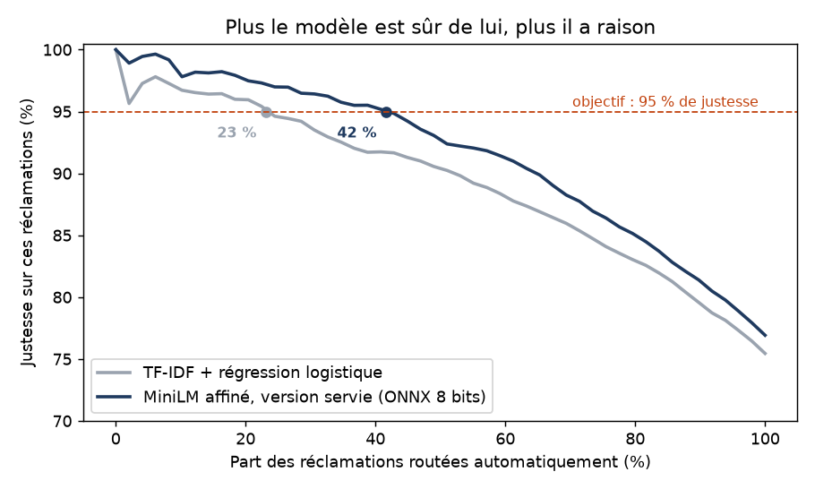
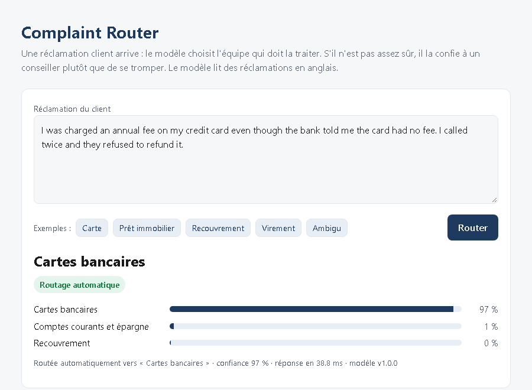
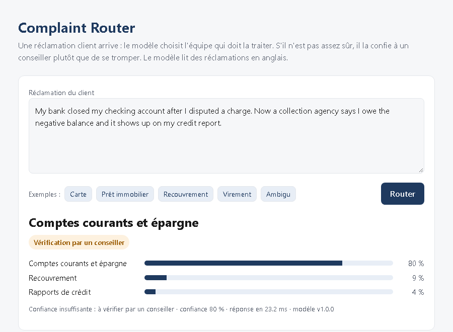
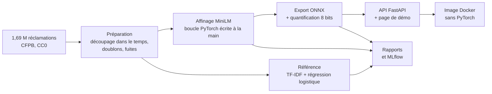

# Complaint Router

[](https://github.com/aminetig/complaint-router/actions/workflows/ci.yml)

**Routage automatique des réclamations clients d'une banque vers la bonne équipe.** Le projet va de bout en bout :
- **Modèle :** un petit Transformer (MiniLM) affiné en PyTorch sur de vraies réclamations, puis quantifié en 8 bits et exporté en ONNX.
- **Service :** une API FastAPI dans une image Docker sans PyTorch.
- **Mesures :** une comparaison chiffrée avec une référence classique et avec un LLM local.

## Le problème

Une banque reçoit chaque jour des milliers de réclamations écrites :

> « J'ai payé des frais annuels sur ma carte alors qu'on m'avait promis une carte sans frais… »

Quelqu'un doit les lire une par une pour les envoyer à la bonne équipe : cartes, prêts immobiliers, recouvrement, etc. C'est lent, et une réclamation mal aiguillée perd des jours en allers-retours.

Le modèle lit la réclamation et propose l'équipe. **Quand il est sûr de lui, la réclamation part seule ; sinon, un conseiller tranche**, avec les 3 équipes les plus probables sous les yeux.

L'objectif métier n'est donc pas « X % de justesse ». C'est : **quelle part des réclamations peut-on router sans humain, en gardant 95 % de justesse sur celles-là ?**

## Résultats

Le test porte sur 4 476 vraies réclamations d'octobre 2023 à février 2024. Elles sont **postérieures** à toutes celles de l'entraînement, comme en production, et équilibrées entre les 9 équipes.

| Modèle | F1 macro | Part routable seule à 95 % de justesse | Temps de réponse | Taille |
| --- | --- | --- | --- | --- |
| Référence : TF-IDF + régression logistique | 0,756 | 23 % | 3 ms | – |
| MiniLM affiné en PyTorch | 0,769 | 40 % | 59 ms | 91 Mo |
| **MiniLM, ONNX quantifié 8 bits (version servie)** | **0,769** | **42 %** | **43 ms** | **23 Mo** |



Ce qu'il faut retenir :

- **À justesse égale de 95 %, le Transformer route seul presque deux fois plus de réclamations que la référence** : 42 % contre 23 %. Ses scores de confiance sont plus fiables : quand il est sûr, il a raison.
- **La quantification ne coûte presque rien.** Le modèle est 4 fois plus petit et 1,4 fois plus rapide, pour une perte de F1 de 0,0004.
- **Un piège évité : en 8 bits, le score d'une réclamation dépendait de ses voisines dans un lot.** 2,1 % des réclamations changeaient de catégorie selon les autres textes traités en même temps. Le modèle servi traite donc chaque réclamation seule : la même réclamation reçoit toujours la même décision ([journal](docs/journal.md)).
- **En conditions réelles**, le seuil est choisi sur la validation (été 2023), sans regarder le test. La version servie route alors seule 49 % des réclamations du test, avec **93,0 %** de justesse. L'écart avec la cible de 95 % vient de la dérive des réclamations entre l'été et l'hiver : c'est exactement ce qu'un découpage dans le temps permet de voir, et ce qu'un tirage au hasard aurait caché.
- **Le gain en F1 brut est modeste** (+1,3 point). Les étiquettes sont le produit choisi par le consommateur, et elles se recouvrent : un virement contesté part d'un compte, une dette en recouvrement apparaît sur le rapport de crédit. Parmi les erreurs où le modèle est sûr à 99 %, on trouve des lettres qui citent la loi sur les rapports de crédit, classées « recouvrement » par leur auteur. Le modèle a probablement raison. Détails dans la [fiche du modèle](docs/model_card.md).

Tous les chiffres sont produits par le code et consignés dans [`reports/`](reports/), avec le tableau complet dans [`reports/RESULTS.md`](reports/RESULTS.md). Les temps de réponse ont été mesurés sur un portable de 2017 (Intel Core i5-7300U, 2 cœurs, sans carte graphique).

### Et si on demandait simplement à un LLM ?

C'est la question qu'on pose aujourd'hui avant d'entraîner quoi que ce soit. Pour y répondre, j'ai fait classer à Qwen2.5 3B (3 milliards de paramètres) 180 réclamations du test, 20 par équipe.
- **Conditions :** le LLM tourne en local avec Ollama, car une banque n'envoie pas les réclamations de ses clients à un service externe.
- **Consigne :** il reçoit la description des 9 équipes, et sa réponse est contrainte à l'une d'elles par un schéma JSON.

| Sur les mêmes 180 réclamations | F1 macro | Justesse | Temps par réclamation |
| --- | --- | --- | --- |
| Qwen2.5 3B, sans entraînement | 0,561 | 56,1 % | 23 s |
| **MiniLM affiné (version servie)** | **0,771** | **77,2 %** | **36 ms** |

Le petit modèle spécialisé est meilleur de 21 points et environ **640 fois plus rapide** sur le même processeur. Le LLM garde un avantage : il ne demande aucune donnée étiquetée, et il peut servir à démarrer quand on n'en a pas.

Un premier essai donnait au LLM un F1 de 0,43 seulement. Cet écart était trop beau : le prompt ne demandait pas de JSON, et la contrainte de format déformait les réponses. Corrigé et mesuré à nouveau ([journal](docs/journal.md)).

## Essayer

Le modèle entraîné est versionné dans [`models/`](models/) (23 Mo). Il n'y a rien à entraîner pour lancer l'API.

```bash
make docker        # construit l'image (ONNX Runtime + tokenizers, sans PyTorch : 127 Mo)
make docker-run    # http://localhost:8000 : page de démonstration ; /docs : documentation de l'API
```

Ou sans Docker, avec Python 3.11 :

```bash
make setup         # environnement Python et dépendances
make serve         # http://localhost:8000
```

```bash
curl -X POST localhost:8000/predict -H "Content-Type: application/json" \
  -d '{"text": "I was charged an annual fee on my credit card even though the bank told me the card had no fee. I called twice and they refused to refund it."}'
```

```json
{
  "label": "cards",
  "team": "Cartes bancaires",
  "confidence": 0.9722,
  "auto_route": true,
  "decision": "Routée automatiquement vers « Cartes bancaires »",
  "top3": [
    {"label": "cards", "team": "Cartes bancaires", "probability": 0.9722},
    {"label": "bank_account", "team": "Comptes courants et épargne", "probability": 0.0139},
    {"label": "debt_collection", "team": "Recouvrement", "probability": 0.0047}
  ],
  "latency_ms": 27.6,
  "model_version": "1.0.0"
}
```

Sur un cas mêlant plusieurs sujets (compte fermé, dette en recouvrement, rapport de crédit), le modèle hésite et passe la main à un conseiller :

| Cas clair : routage automatique | Cas mêlé : vérification par un conseiller |
| --- | --- |
|  |  |

Pour publier la démo gratuitement sur Hugging Face Spaces : `make space HF_TOKEN=hf_xxx`.

## Comment ça marche



1. **Données** ([`data.py`](src/complaint_router/data.py)) :
   - 1,69 million de réclamations lues en flux, sans tout charger en mémoire.
   - Découpage par date : entraînement de janvier 2022 à juin 2023, validation de juillet à septembre 2023, test d'octobre 2023 à février 2024.
   - 1 200 exemples par équipe pour l'entraînement, tirés uniformément (« reservoir sampling »).
   - Les **lettres types** déjà vues à l'entraînement sont retirées de la validation et du test : 361 textes, qui auraient faussé la mesure.
2. **Référence** ([`baseline.py`](src/complaint_router/baseline.py)) : TF-IDF sur les mots et paires de mots, puis régression logistique. C'est le point de comparaison honnête : un modèle complexe doit faire mieux que lui.
3. **Affinage** ([`model.py`](src/complaint_router/model.py), [`train.py`](src/complaint_router/train.py)) :
   - MiniLM pré-entraîné (22,7 millions de paramètres), moyenne des vecteurs des mots, puis une couche de classification.
   - Boucle PyTorch écrite à la main : AdamW, warmup puis décroissance du pas, écrêtage des gradients, arrêt anticipé sur la validation.
   - 2 h 17 sur processeur. Chaque essai est suivi dans MLflow.
4. **Seuil de confiance** ([`metrics.py`](src/complaint_router/metrics.py)) : le plus bas qui garde 95 % de justesse sur la validation. En dessous, la réclamation va à un conseiller.
5. **Export** ([`export_onnx.py`](src/complaint_router/export_onnx.py)) :
   - export ONNX, vérifié contre PyTorch (écart maximal de 0,0000013) ;
   - quantification dynamique en 8 bits, avec un seuil recalculé pour le modèle quantifié ;
   - mesure des temps de réponse des trois versions.
6. **Service** ([`predictor.py`](src/complaint_router/predictor.py), [`app/main.py`](app/main.py)) :
   - ONNX Runtime et `tokenizers` seulement ;
   - une réclamation à la fois, pour qu'un score ne dépende jamais des autres textes ;
   - échauffement au démarrage, pour que le premier client n'attende pas ;
   - entrées validées par Pydantic ;
   - page de démonstration ;
   - image Docker avec un utilisateur non root et une vérification de santé (healthcheck).

Chaque choix est justifié, avec l'alternative écartée, dans [`docs/decisions.md`](docs/decisions.md). Les problèmes rencontrés et leurs solutions sont dans [`docs/journal.md`](docs/journal.md).

## Tout reproduire

```bash
make setup      # Python 3.11, PyTorch processeur, etc.
make download   # 925 Mo de réclamations (copie CC0 sur Hugging Face)
make data       # jeux train / validation / test
make baseline   # référence TF-IDF, 1 minute
make train      # affinage MiniLM, environ 2 h sur processeur, quelques minutes sur GPU
make export     # ONNX, quantification, mesures de vitesse
make llm        # comparaison avec un LLM local (Ollama doit tourner : ollama pull qwen2.5:3b)
make report     # tableau et graphiques dans reports/
make mlflow     # historique des essais sur http://localhost:5000
```

Les résultats sont reproductibles : graine fixée, échantillonnage déterministe, versions des bibliothèques figées.

## Qualité

- **Tests** (`make test`, pytest) :
  - nettoyage du texte et correspondance des catégories ;
  - échantillonnage et découpage temporel ;
  - mesures et choix du seuil ;
  - modèle servi : probabilités, cohérence entre un lot et une prédiction seule ;
  - API : réponses, validation des entrées, limites.
- **Intégration continue** (GitHub Actions), en trois étapes :
  - style du code (ruff) ;
  - tests, sans installer PyTorch ;
  - construction de l'image Docker, démarrage, puis une vraie prédiction vérifiée de bout en bout.

## Ce que montre ce projet

| Domaine | Ce qui est fait |
| --- | --- |
| Deep learning | Affinage d'un Transformer pré-entraîné en PyTorch, boucle d'entraînement écrite à la main |
| NLP | Tokenisation, troncature, nettoyage de vrais textes (masques d'anonymisation, lettres types) |
| Évaluation | Découpage dans le temps, chasse aux fuites, F1 macro, seuil de confiance, coût métier, analyse d'erreurs |
| Mise en production | Export ONNX, quantification 8 bits, mesures de vitesse, API FastAPI, Docker |
| MLOps | Suivi des essais avec MLflow, tests, intégration continue, version du modèle exposée par l'API |
| Données | 1,69 million de lignes lues en flux (Parquet, pyarrow), échantillonnage uniforme, dédoublonnage par empreinte |
| LLM | Comparaison avec un LLM local (Ollama), réponse contrainte par un schéma JSON |

## Organisation du dépôt

```
src/complaint_router/   le code : données, référence, entraînement, export, prédiction
app/                    API FastAPI et page de démonstration
models/                 modèle servi (ONNX 8 bits), tokenizer et seuil
reports/                résultats chiffrés et graphiques
tests/                  tests automatiques
docs/                   choix techniques, journal, fiche du modèle
scripts/                publication de la démo sur Hugging Face Spaces
```

## Limites

- Le modèle lit les **128 premiers jetons** (environ 90 mots) : c'est le prix d'un entraînement sur processeur. La référence TF-IDF lit tout le texte. C'est pourquoi elle garde un léger avantage sur la justesse attendue sur le vrai flux, où les rapports de crédit dominent : 77,3 % contre 76,4 %.
- Les étiquettes sont le choix du consommateur : une partie des « erreurs » n'en sont pas. Un échantillon vérifié par des conseillers donnerait le vrai taux d'erreur.
- Réclamations américaines, en anglais, de 2022 à 2024. En production, il faudrait suivre la justesse chaque mois et réentraîner régulièrement.

## Données et licence

- **Données :** réclamations publiées par le [Consumer Financial Protection Bureau](https://www.consumerfinance.gov/data-research/consumer-complaints/), via une copie de février 2024 sous licence CC0 ([`BEE-spoke-data/consumer-finance-complaints`](https://huggingface.co/datasets/BEE-spoke-data/consumer-finance-complaints)). Le texte des réclamations n'est plus disponible dans l'API officielle en novembre 2026.
- **Modèle de départ :** [`all-MiniLM-L6-v2`](https://huggingface.co/sentence-transformers/all-MiniLM-L6-v2), sous licence Apache 2.0.
- **Code :** licence MIT.
